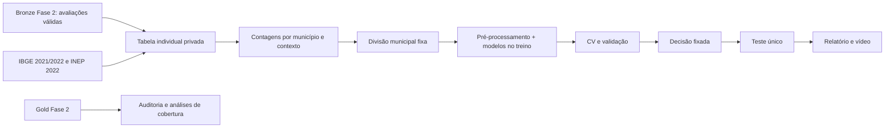

# Arquitetura da versão acadêmica

SQLite foi suporte local de preparação e auditoria; não é uma exigência da entrega nem define uma arquitetura cloud. Esta distribuição usa dados agregados em JSON e artefatos Scikit-learn para reproduzir os experimentos. A compressão é válida apenas enquanto as features forem constantes por município; atributos individuais futuros exigirão alterar a unidade de processamento e o contrato de dados.
