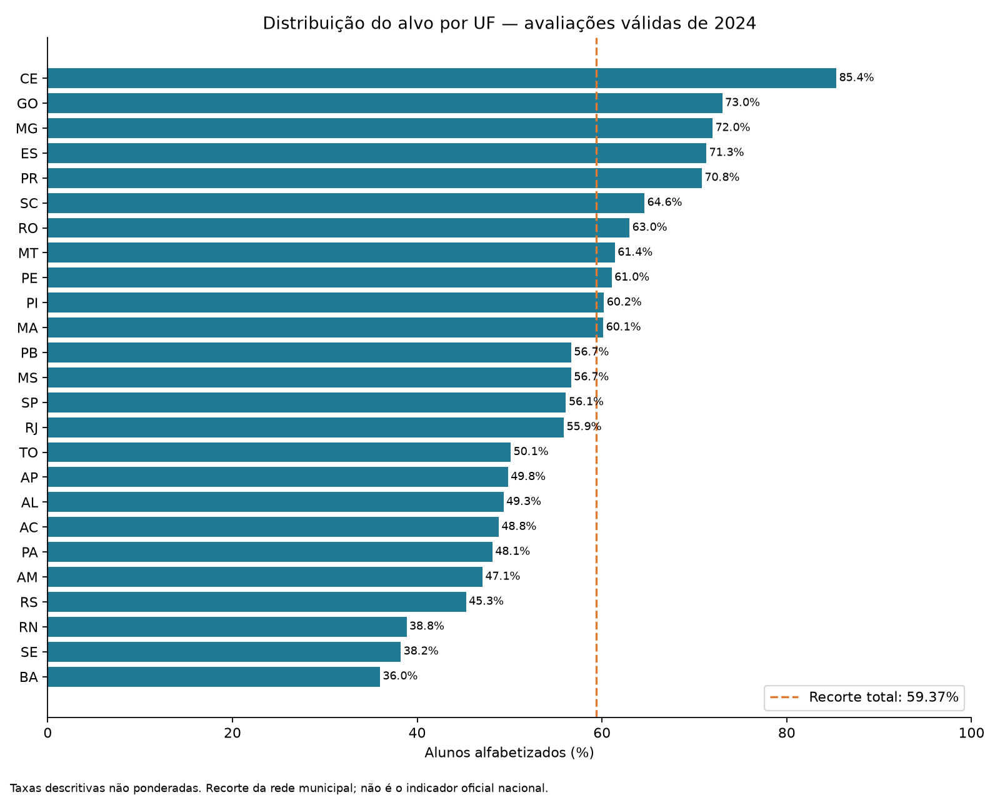
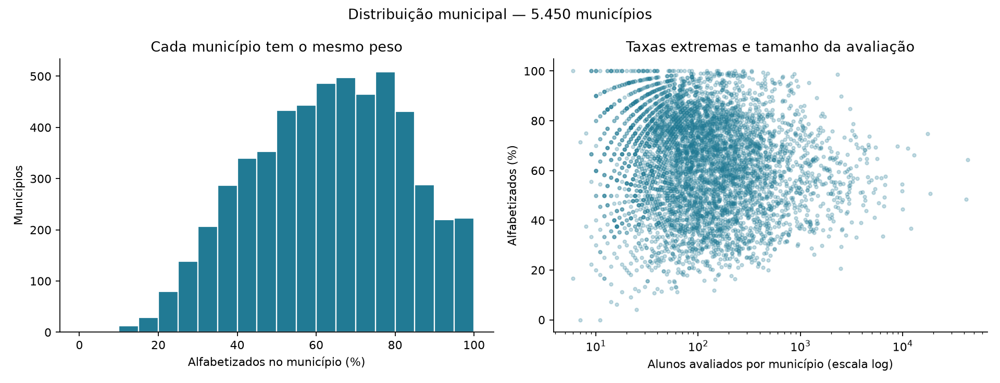
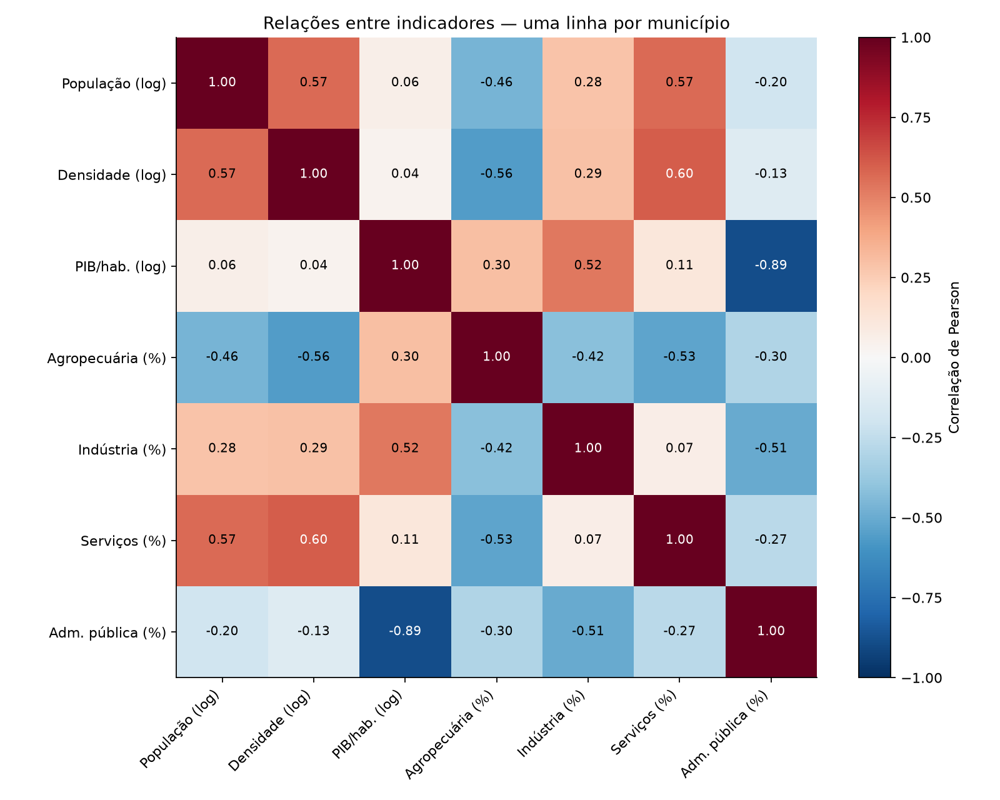
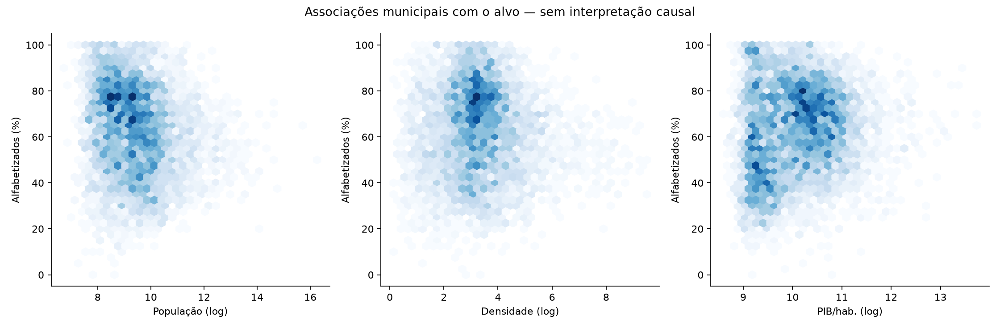

# Análise exploratória da base individual enriquecida

Análise descritiva do recorte de 2024; sem treinamento ou escolha de modelo. Base SQLite aberta somente para leitura. As agregações foram reconciliadas com a contagem individual e o total de rótulos positivos.

## Achados e implicações

1. Há heterogeneidade territorial: CE=85,36%, GO=73,01% e MG=71,96%; BA=35,96%, SE=38,22% e RN=38,85%. São taxas do recorte municipal avaliado, não rankings oficiais das UFs.
2. A associação linear entre indicadores e o rótulo individual é fraca: população em log r=−0,059; densidade em log r=−0,035; PIB/habitante em log r=0,022. Correlação fraca não exclui relações não lineares ou interações, mas não sustenta expectativa de forte previsão individual com estes atributos apenas.
3. No nível municipal, PIB/habitante em log tem r=0,109 com a taxa de alfabetização; após remover médias por UF de ambas as variáveis, r=0,029. A associação bruta depende da composição territorial e não deve ser lida como efeito de renda.
4. PIB/habitante em log e participação da administração pública no VAB apresentam forte correlação inversa (Pearson −0,888; Spearman −0,945). Evitar interpretar coeficientes isolados sem considerar redundância. As participações setoriais somam aproximadamente 100%, criando também dependência composicional.
5. Os 42.157 alunos de 218 municípios fora da Gold têm taxa de 46,52%, contra 59,72% dentro dela: diferença descritiva de 13,19 pontos percentuais. Excluir o grupo altera a composição da base e aumenta a taxa global em aproximadamente 0,35 ponto percentual.
6. Cachoeira Dourada/GO tem participações setoriais atípicas na fonte. Excluir apenas esse município muda todas as correlações municipais indicador/alvo em menos de 0,002, mas isso não avalia sua influência em um modelo futuro.
7. Preservar os extremos na base original. Avaliar transformações e sensibilidade dentro do treino, separar municípios inteiros para validação e considerar indicadores educacionais anteriores ao exame para enriquecer o sinal disponível.

## Distribuição do alvo

- 1.610.754 avaliações válidas: 956.343 alfabetizados (59,37%) e 654.411 não alfabetizados (40,63%).
- 5.450 municípios e 25 UFs (DF e RR não aparecem neste recorte; AC está presente nos microdados, embora ausente da Gold anterior).
- Taxa simples por aluno: 59,37%; sensibilidade com peso amostral: 58,82%.
- Média das taxas municipais: 62,89%; mediana: 64,17%. A diferença decorre do peso igual por município, distinto do peso por aluno.
- Entre os percentis 10 e 90, as taxas municipais vão de 36,40% a 87,81%. Dois municípios têm taxa zero e 58 têm taxa de 100%.
- 617 municípios têm menos de 30 alunos avaliados; a contagem por município varia de 6 a 43.340.

Os percentuais principais são contagens simples. A taxa ponderada é uma análise de sensibilidade usando `peso_amostral`, não uma reprodução validada do estimador oficial. Ausentes e cadernos inválidos já foram excluídos; a distribuição não descreve todos os matriculados. Nenhum valor extremo foi removido.

### Por UF

| sigla_uf | n | municipios | taxa | taxa_ponderada |
| --- | --- | --- | --- | --- |
| BA | 103802 | 407 | 35.965 | 35.965 |
| SE | 15671 | 75 | 38.217 | 38.047 |
| RN | 19312 | 167 | 38.846 | 38.160 |
| RS | 61053 | 456 | 45.279 | 44.311 |
| AM | 35527 | 62 | 47.063 | 46.473 |
| PA | 77334 | 144 | 48.135 | 47.583 |
| AC | 5748 | 22 | 48.817 | 48.159 |
| AL | 30216 | 102 | 49.335 | 49.048 |
| AP | 8287 | 16 | 49.813 | 49.277 |
| TO | 16799 | 139 | 50.122 | 50.054 |
| RJ | 125536 | 92 | 55.865 | 55.222 |
| SP | 298904 | 626 | 56.095 | 55.717 |
| MS | 36514 | 79 | 56.658 | 56.027 |
| PB | 29824 | 221 | 56.666 | 55.976 |
| MA | 62847 | 217 | 60.130 | 59.612 |
| PI | 30973 | 224 | 60.207 | 59.767 |
| PE | 75803 | 184 | 61.049 | 60.765 |
| MT | 43701 | 140 | 61.392 | 61.033 |
| RO | 18618 | 52 | 62.971 | 62.569 |
| SC | 53262 | 289 | 64.592 | 62.874 |
| PR | 119630 | 399 | 70.809 | 70.434 |
| ES | 40525 | 78 | 71.292 | 70.916 |
| MG | 142430 | 830 | 71.964 | 71.453 |
| GO | 70749 | 245 | 73.013 | 72.738 |
| CE | 87689 | 184 | 85.364 | 85.349 |

### Por município

| n | municipios | alunos | taxa_media_municipal |
| --- | --- | --- | --- |
| <30 | 617 | 12587 | 64.683 |
| 30–99 | 2052 | 124628 | 64.926 |
| 100–499 | 2191 | 478039 | 61.510 |
| 500–999 | 309 | 213404 | 60.415 |
| ≥1000 | 281 | 782096 | 57.483 |

As taxas extremas em municípios pequenos têm menor estabilidade. Não interpretar a ordenação como avaliação de qualidade da escola ou efeito causal de políticas. O arquivo `distribuicao_municipal.json` contém as contagens e taxas dos 5.450 municípios.

### Cobertura da Gold da Fase 2

| municipio_na_gold_fase2 | n | positivos | municipios | taxa |
| --- | --- | --- | --- | --- |
| 0 | 42157 | 19613 | 218 | 46.524 |
| 1 | 1568597 | 936730 | 5232 | 59.718 |

O valor 0 identifica municípios fora da Gold; o valor 1, dentro. A taxa e o tamanho desses grupos permitem verificar seleção introduzida pelo filtro de cobertura, sem assumir que sejam equivalentes.

## Valores extremos

| feature | min | p01 | median | p99 | max | iqr_flag_count | min_municipio | max_municipio |
| --- | --- | --- | --- | --- | --- | --- | --- | --- |
| n | 6.000 | 12.000 | 103.000 | 3182.670 | 43340.000 | 585 | Verdelândia - MG | Rio de Janeiro - RJ |
| taxa | 0.000 | 20.382 | 64.167 | 100.000 | 100.000 | 3 | São Pedro - RN | Bacurituba - MA |
| populacao_2022 | 833.000 | 1752.410 | 11173.000 | 418437.970 | 11451999.000 | 596 | Serra da Saudade - MG | São Paulo - SP |
| area_km2_2022 | 3.565 | 42.421 | 420.490 | 18028.016 | 159533.306 | 647 | Santa Cruz de Minas - MG | Altamira - PA |
| densidade_hab_km2_2022 | 0.150 | 0.910 | 24.645 | 2226.796 | 13416.810 | 641 | Barcelos - AM | Taboão da Serra - SP |
| pib_por_habitante_reais_2021 | 5406.451 | 7174.370 | 23220.229 | 201537.723 | 920828.362 | 310 | Santana do Maranhão - MA | Catas Altas - MG |
| participacao_agropecuaria_2021 | -41.900 | 0.070 | 18.740 | 73.795 | 93.500 | 28 | Cachoeira Dourada - GO | Sucupira - TO |
| participacao_industria_2021 | 0.480 | 2.020 | 7.200 | 71.238 | 209.600 | 418 | Sucupira - TO | Cachoeira Dourada - GO |
| participacao_servicos_2021 | -42.010 | 9.074 | 29.300 | 68.448 | 87.670 | 72 | Cachoeira Dourada - GO | Osasco - SP |
| participacao_administracao_publica_2021 | -25.700 | 4.499 | 26.740 | 68.411 | 76.290 | 0 | Cachoeira Dourada - GO | Santo Antônio dos Milagres - PI |

Flags de IQR são observações abaixo de Q1−1,5×IQR ou acima de Q3+1,5×IQR. São sinalizadores exploratórios, não erros comprovados. Tamanho populacional, área e PIB são naturalmente assimétricos; não excluir municípios grandes automaticamente. Em Cachoeira Dourada/GO, participações do VAB retornadas pelo IBGE incluem valores negativos e indústria acima de 100%; os valores foram mantidos e a correlação sem esse município foi calculada como sensibilidade. Conferir a origem econômica antes de qualquer correção.

## Relações entre indicadores e alvo

| feature | pearson_municipal | spearman_municipal | pearson_aluno_contexto | pearson_residuos_dentro_uf | pearson_sem_anomalia |
| --- | --- | --- | --- | --- | --- |
| log1p_populacao_2022 | -0.167 | -0.188 | -0.059 | -0.217 | -0.167 |
| log1p_densidade_hab_km2_2022 | -0.033 | -0.021 | -0.035 | -0.106 | -0.033 |
| log1p_pib_por_habitante_reais_2021 | 0.109 | 0.115 | 0.022 | 0.029 | 0.109 |
| participacao_agropecuaria_2021 | 0.096 | 0.134 | 0.042 | 0.117 | 0.097 |
| participacao_industria_2021 | 0.017 | 0.011 | 0.017 | -0.031 | 0.015 |
| participacao_servicos_2021 | 0.026 | 0.047 | -0.029 | -0.113 | 0.027 |
| participacao_administracao_publica_2021 | -0.141 | -0.126 | -0.029 | -0.004 | -0.140 |

`pearson_municipal` e `spearman_municipal` usam uma linha por município. Spearman é Pearson dos postos com empates médios. `pearson_aluno_contexto` é a correlação ponto-bisserial exata entre o indicador contextual e o alvo binário, calculada pelas contagens municipais; distingue associação ecológica de discriminação individual. `pearson_residuos_dentro_uf` remove as médias de cada UF de ambas as variáveis, com municípios igualmente ponderados; é uma descrição dentro das UFs, não ajuste causal. `pearson_sem_anomalia` exclui somente Cachoeira Dourada/GO.

As correlações são exploratórias e usam a base completa, sem teste de significância. As unidades independentes não são 1,61 milhão de contextos: os indicadores se repetem por município. Não atribuir causalidade, nem tratar correlação municipal como garantia de previsão individual. A escolha de features deve ser reavaliada apenas no treino após separar municípios, mantendo a avaliação final isolada. Como esta EDA observou toda a base, um split posterior será um holdout interno, não uma validação externa completamente intocada.

## Procedência e limites

Indicadores IBGE de 2021/2022, consultados em 2026; versões históricas exatas não foram recuperadas. Fontes, hashes, unidades e seleção inicial de features estão na documentação `../base-fase3/README.md` e nos manifestos associados. Há somente um ano de alvo observado. Não há dados de renda familiar, trajetória individual ou intervenção que sustentem interpretação causal. Não houve imputação, normalização aprendida, cap de extremos ou alteração do banco original.
