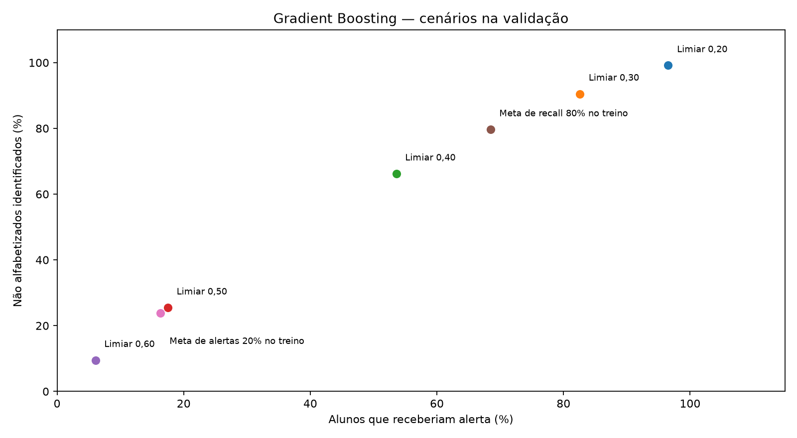

# Enriquecimento escolar, comparação de modelos e limiares

## Conclusão e recomendação atualizada

O enriquecimento direto por escola não foi possível: houve zero correspondências entre os identificadores disponíveis e os códigos escolares do INEP. Foi aplicado e documentado o enriquecimento educacional municipal, com cobertura de contexto em todos os municípios e poucos indicadores ausentes. Não é correto atribuir esses valores à escola específica do aluno.

O Gradient Boosting de profundidade 3 foi selecionado pela média de AP nos folds municipais do treino (0,5292), antes de avaliar a validação. Nela, obteve AP=0,5357, contra 0,5405 da logística contextual e 0,5385 da logística com contexto educacional. A melhor floresta desta rodada teve AP=0,5347. Portanto, esta rodada não demonstrou ganho sobre a logística simples anterior; não substituí-la automaticamente por maior complexidade.

A diferença de AP do boosting em relação à logística contextual foi −0,0048. O intervalo bootstrap de municípios, condicional aos modelos ajustados, foi [−0,0148; 0,0053]. Não há evidência clara de superioridade nesta amostra. O pequeno conjunto de candidatos e três folds não esgotam as possibilidades de modelagem.

No limiar 0,50, o boosting identifica 25,44% dos não alfabetizados, com precisão de 59,22%. O limiar 0,3643, derivado no treino para recall de pelo menos 80%, alcança 79,65% na validação, mas alerta 68,46% de todos os alunos: 219.513 alertas, incluindo 115.521 falsos positivos. Isso explicita o custo de ampliar a cobertura; não equivale a melhora de discriminação.

A decisão recomendada é manter a logística contextual como referência de simplicidade e registrar o boosting como candidato selecionado por CV nesta rodada. Não declarar modelo ou limiar operacional definitivo. Antes de avançar ao teste, definir o compromisso entre falsos negativos e capacidade de atendimento; para obter informação mais individual, será necessária uma chave escolar válida ou outro conjunto autorizado de atributos anteriores ao exame. Não tentar deduzir a identidade das escolas por aproximação.

Todos os seis modelos foram recarregados e suas métricas de AP e matrizes de confusão conferidas por expansão para 320.639 alunos da validação. Nenhum score ou métrica de teste foi calculado.

## Protocolo

Classe de interesse: não alfabetizado. Mesma divisão refinada e mesmo conjunto de alunos da rodada anterior. Teste reservado: nenhum score ou métrica de teste foi calculado. O novo banco escolar foi consultado explicitamente só para treino/validação.

A integração direta por escola não encontrou correspondência entre identificadores. Foram integradas médias simples municipais calculadas das escolas municipais do INEP 2022: alunos por turma nos anos iniciais e no 2º ano, percentual de funções docentes com curso superior e percentual de escolas rurais. São proxies calculadas neste projeto, não indicadores municipais oficiais ponderados. Não há histórico de desempenho individual. O indicador DSU mede funções docentes, não quantidade de professores distintos. Todos os alunos de um mesmo município continuam recebendo o mesmo score. Não se afirma enriquecimento escolar individual.

Os municípios de treino foram divididos em três folds estratificados por UF. Escolas de um mesmo município permaneceram no mesmo fold. Mediana de imputação, indicadores de ausência, escala e one-hot foram ajustados somente nos folds de treino. Comparação pré-definida por média de AP nos três folds; parâmetros e lista de candidatos foram gravados em `protocolo.json` antes dos ajustes. Não foi usada a validação externa ao treino para escolher hiperparâmetros. Os folds são estratificados por UF, mas não garantem proporção exata de alunos em cada fold.

## Validação cruzada no treino

| candidate | mean | std |
| --- | --- | --- |
| gb_prof3 | 0.5292 | 0.0082 |
| gb_prof2 | 0.5266 | 0.0046 |
| rf_prof12 | 0.5244 | 0.0074 |
| rf_prof8 | 0.5234 | 0.0065 |
| logistica_educacional | 0.5226 | 0.0095 |
| logistica_contexto | 0.5199 | 0.0142 |

Configuração selecionada no treino: **gb_prof3**.

## Resultados na validação, limiar 0,50

| model | AP | ROC_AUC | precision | recall | F1 | Brier | alerts | FP | FN |
| --- | --- | --- | --- | --- | --- | --- | --- | --- | --- |
| logistica_contexto | 0.5405 | 0.6490 | 0.5893 | 0.2458 | 0.3469 | 0.2258 | 54463 | 22367 | 98471 |
| logistica_educacional | 0.5385 | 0.6483 | 0.5929 | 0.2447 | 0.3464 | 0.2258 | 53890 | 21941 | 98618 |
| rf_prof8 | 0.5301 | 0.6394 | 0.6131 | 0.1684 | 0.2642 | 0.2282 | 35862 | 13874 | 108579 |
| rf_prof12 | 0.5347 | 0.6440 | 0.5971 | 0.2155 | 0.3167 | 0.2265 | 47129 | 18988 | 102426 |
| gb_prof2 | 0.5313 | 0.6394 | 0.6174 | 0.1374 | 0.2248 | 0.2279 | 29054 | 11115 | 112628 |
| gb_prof3 | 0.5357 | 0.6452 | 0.5922 | 0.2544 | 0.3559 | 0.2262 | 56096 | 22875 | 97346 |
| referencia_global | 0.4072 | 0.5000 | 0.0000 | 0.0000 | 0.0000 | 0.2414 | 0 | 0 | 130567 |
| referencia_uf | 0.5214 | 0.6377 | 0.5741 | 0.3020 | 0.3958 | 0.2270 | 68675 | 29249 | 91141 |

AP é average precision, resumo da curva precisão–recall, não sua integral trapezoidal. Métricas ponderadas por contagens de alunos, não pesos amostrais INEP. O baseline por UF usa apenas prevalência no treino. A comparação entre logística contextual e educacional municipal ajuda a separar o efeito do enriquecimento da mudança de algoritmo.

## Limiar e custo em alertas

| scenario | threshold | precision | recall | F1 | alerts | alert_fraction | FP | FN | TP |
| --- | --- | --- | --- | --- | --- | --- | --- | --- | --- |
| fixo_0.2 | 0.2000 | 0.4182 | 0.9914 | 0.5883 | 309538 | 0.9654 | 180090 | 1119 | 129448 |
| fixo_0.3 | 0.3000 | 0.4462 | 0.9049 | 0.5977 | 264802 | 0.8259 | 146647 | 12412 | 118155 |
| fixo_0.4 | 0.4000 | 0.5030 | 0.6620 | 0.5717 | 171826 | 0.5359 | 85390 | 44131 | 86436 |
| fixo_0.5 | 0.5000 | 0.5922 | 0.2544 | 0.3559 | 56096 | 0.1750 | 22875 | 97346 | 33221 |
| fixo_0.6 | 0.6000 | 0.6371 | 0.0948 | 0.1650 | 19428 | 0.0606 | 7050 | 118189 | 12378 |
| recall_80_no_treino_OOF | 0.3643 | 0.4737 | 0.7965 | 0.5941 | 219513 | 0.6846 | 115521 | 26575 | 103992 |
| capacidade_20_no_treino_OOF | 0.5054 | 0.5938 | 0.2385 | 0.3404 | 52455 | 0.1636 | 21309 | 99421 | 31146 |

Os limiares 0,20/0,30/0,40/0,50/0,60 são cenários fixos. Os limiares de recall de 80% e de capacidade de 20% foram calculados no score out-of-fold do treino, sem olhar o alvo da validação. São metas no treino, não garantias na validação. Empates de score são mantidos, sem fracionar municípios para impor artificialmente uma capacidade. Não foi escolhido um limiar operacional, pois faltam os custos de erro e a capacidade de atendimento. Falsos positivos são alunos alfabetizados que receberiam alerta; falsos negativos são não alfabetizados não identificados.

## Desempenho por UF

| model | uf | threshold | students | AP | precision | recall | FP | FN |
| --- | --- | --- | --- | --- | --- | --- | --- | --- |
| logistica_contexto | AC | 0.5000 | 1151 | 0.4759 | 0.4020 | 0.4123 | 360 | 345 |
| logistica_contexto | AL | 0.5000 | 6044 | 0.5708 | 0.5792 | 0.5349 | 1190 | 1424 |
| logistica_contexto | AM | 0.5000 | 6045 | 0.5953 | 0.6460 | 0.3026 | 577 | 2427 |
| logistica_contexto | AP | 0.5000 | 1192 | 0.5019 | 0.0000 | 0.0000 | 0 | 641 |
| logistica_contexto | BA | 0.5000 | 20760 | 0.6649 | 0.6404 | 1.0000 | 7466 | 0 |
| logistica_contexto | CE | 0.5000 | 17538 | 0.2475 | 0.0000 | 0.0000 | 0 | 2567 |
| logistica_contexto | ES | 0.5000 | 8107 | 0.3409 | 0.0000 | 0.0000 | 0 | 2327 |
| logistica_contexto | GO | 0.5000 | 14150 | 0.3040 | 0.0000 | 0.0000 | 0 | 3819 |
| logistica_contexto | MA | 0.5000 | 12569 | 0.4077 | 0.0000 | 0.0000 | 0 | 5011 |
| logistica_contexto | MG | 0.5000 | 28486 | 0.2951 | 0.0000 | 0.0000 | 0 | 7986 |
| logistica_contexto | MS | 0.5000 | 7302 | 0.4561 | 0.0000 | 0.0000 | 0 | 3165 |
| logistica_contexto | MT | 0.5000 | 8740 | 0.4048 | 0.0000 | 0.0000 | 0 | 3374 |
| logistica_contexto | PA | 0.5000 | 15467 | 0.5233 | 0.5167 | 0.6855 | 5143 | 2523 |
| logistica_contexto | PB | 0.5000 | 5965 | 0.4898 | 0.0000 | 0.0000 | 0 | 2585 |
| logistica_contexto | PE | 0.5000 | 15161 | 0.4288 | 0.0000 | 0.0000 | 0 | 5905 |
| logistica_contexto | PI | 0.5000 | 6195 | 0.4746 | 0.0000 | 0.0000 | 0 | 2465 |
| logistica_contexto | PR | 0.5000 | 23926 | 0.3547 | 0.0000 | 0.0000 | 0 | 6984 |
| logistica_contexto | RJ | 0.5000 | 25114 | 0.5756 | 0.0000 | 0.0000 | 0 | 11237 |
| logistica_contexto | RN | 0.5000 | 3862 | 0.6245 | 0.6116 | 1.0000 | 1500 | 0 |
| logistica_contexto | RO | 0.5000 | 3726 | 0.3662 | 0.0000 | 0.0000 | 0 | 1380 |
| logistica_contexto | RS | 0.5000 | 12211 | 0.5653 | 0.5587 | 0.8363 | 4413 | 1094 |
| logistica_contexto | SC | 0.5000 | 10652 | 0.3458 | 0.0000 | 0.0000 | 0 | 3772 |
| logistica_contexto | SE | 0.5000 | 3135 | 0.6743 | 0.6179 | 1.0000 | 1198 | 0 |
| logistica_contexto | SP | 0.5000 | 59781 | 0.4742 | 0.0000 | 0.0000 | 0 | 26247 |
| logistica_contexto | TO | 0.5000 | 3360 | 0.4919 | 0.4816 | 0.2882 | 520 | 1193 |
| logistica_educacional | AC | 0.5000 | 1151 | 0.4756 | 0.4863 | 0.8194 | 508 | 106 |
| logistica_educacional | AL | 0.5000 | 6044 | 0.4566 | 0.4715 | 0.4350 | 1493 | 1730 |
| logistica_educacional | AM | 0.5000 | 6045 | 0.6289 | 0.6016 | 0.7069 | 1629 | 1020 |
| logistica_educacional | AP | 0.5000 | 1192 | 0.7252 | 0.0000 | 0.0000 | 0 | 641 |
| logistica_educacional | BA | 0.5000 | 20760 | 0.6560 | 0.6422 | 0.9768 | 7234 | 309 |
| logistica_educacional | CE | 0.5000 | 17538 | 0.2810 | 0.0000 | 0.0000 | 0 | 2567 |
| logistica_educacional | ES | 0.5000 | 8107 | 0.3413 | 0.0000 | 0.0000 | 0 | 2327 |
| logistica_educacional | GO | 0.5000 | 14150 | 0.3044 | 0.0000 | 0.0000 | 0 | 3819 |
| logistica_educacional | MA | 0.5000 | 12569 | 0.3856 | 0.0000 | 0.0000 | 0 | 5011 |
| logistica_educacional | MG | 0.5000 | 28486 | 0.2931 | 0.0000 | 0.0000 | 0 | 7986 |
| logistica_educacional | MS | 0.5000 | 7302 | 0.4485 | 0.0000 | 0.0000 | 0 | 3165 |
| logistica_educacional | MT | 0.5000 | 8740 | 0.3971 | 0.0000 | 0.0000 | 0 | 3374 |
| logistica_educacional | PA | 0.5000 | 15467 | 0.5238 | 0.5419 | 0.5890 | 3994 | 3297 |
| logistica_educacional | PB | 0.5000 | 5965 | 0.4798 | 0.5312 | 0.0263 | 60 | 2517 |
| logistica_educacional | PE | 0.5000 | 15161 | 0.3983 | 0.0000 | 0.0000 | 0 | 5905 |
| logistica_educacional | PI | 0.5000 | 6195 | 0.4970 | 0.0000 | 0.0000 | 0 | 2465 |
| logistica_educacional | PR | 0.5000 | 23926 | 0.3549 | 0.0000 | 0.0000 | 0 | 6984 |
| logistica_educacional | RJ | 0.5000 | 25114 | 0.5683 | 0.0000 | 0.0000 | 0 | 11237 |
| logistica_educacional | RN | 0.5000 | 3862 | 0.6355 | 0.6186 | 0.9848 | 1434 | 36 |
| logistica_educacional | RO | 0.5000 | 3726 | 0.3950 | 0.0000 | 0.0000 | 0 | 1380 |
| logistica_educacional | RS | 0.5000 | 12211 | 0.5641 | 0.5625 | 0.8153 | 4237 | 1234 |
| logistica_educacional | SC | 0.5000 | 10652 | 0.3463 | 0.0000 | 0.0000 | 0 | 3772 |
| logistica_educacional | SE | 0.5000 | 3135 | 0.6788 | 0.6179 | 1.0000 | 1198 | 0 |
| logistica_educacional | SP | 0.5000 | 59781 | 0.4747 | 0.0000 | 0.0000 | 0 | 26247 |
| logistica_educacional | TO | 0.5000 | 3360 | 0.5218 | 0.5484 | 0.1116 | 154 | 1489 |
| gb_prof3 | AC | 0.5000 | 1151 | 0.5267 | 0.0000 | 0.0000 | 0 | 587 |
| gb_prof3 | AL | 0.5000 | 6044 | 0.5199 | 0.4219 | 0.2593 | 1088 | 2268 |
| gb_prof3 | AM | 0.5000 | 6045 | 0.5796 | 0.6021 | 0.5739 | 1320 | 1483 |
| gb_prof3 | AP | 0.5000 | 1192 | 0.7252 | 0.0000 | 0.0000 | 0 | 641 |
| gb_prof3 | BA | 0.5000 | 20760 | 0.6524 | 0.6404 | 1.0000 | 7466 | 0 |
| gb_prof3 | CE | 0.5000 | 17538 | 0.2691 | 0.0000 | 0.0000 | 0 | 2567 |
| gb_prof3 | ES | 0.5000 | 8107 | 0.3418 | 0.0000 | 0.0000 | 0 | 2327 |
| gb_prof3 | GO | 0.5000 | 14150 | 0.2982 | 0.0000 | 0.0000 | 0 | 3819 |
| gb_prof3 | MA | 0.5000 | 12569 | 0.4517 | 0.0000 | 0.0000 | 0 | 5011 |
| gb_prof3 | MG | 0.5000 | 28486 | 0.2948 | 0.0000 | 0.0000 | 0 | 7986 |
| gb_prof3 | MS | 0.5000 | 7302 | 0.4437 | 0.0000 | 0.0000 | 0 | 3165 |
| gb_prof3 | MT | 0.5000 | 8740 | 0.4110 | 0.0000 | 0.0000 | 0 | 3374 |
| gb_prof3 | PA | 0.5000 | 15467 | 0.5090 | 0.5269 | 0.3733 | 2689 | 5027 |
| gb_prof3 | PB | 0.5000 | 5965 | 0.4841 | 0.0000 | 0.0000 | 0 | 2585 |
| gb_prof3 | PE | 0.5000 | 15161 | 0.4236 | 0.0000 | 0.0000 | 0 | 5905 |
| gb_prof3 | PI | 0.5000 | 6195 | 0.4778 | 0.0000 | 0.0000 | 0 | 2465 |
| gb_prof3 | PR | 0.5000 | 23926 | 0.3332 | 0.0000 | 0.0000 | 0 | 6984 |
| gb_prof3 | RJ | 0.5000 | 25114 | 0.5653 | 0.5587 | 0.5169 | 4587 | 5429 |
| gb_prof3 | RN | 0.5000 | 3862 | 0.6323 | 0.6247 | 0.9610 | 1364 | 92 |
| gb_prof3 | RO | 0.5000 | 3726 | 0.4644 | 0.0000 | 0.0000 | 0 | 1380 |
| gb_prof3 | RS | 0.5000 | 12211 | 0.5656 | 0.5682 | 0.5938 | 3015 | 2714 |
| gb_prof3 | SC | 0.5000 | 10652 | 0.3992 | 0.0000 | 0.0000 | 0 | 3772 |
| gb_prof3 | SE | 0.5000 | 3135 | 0.6171 | 0.6179 | 1.0000 | 1198 | 0 |
| gb_prof3 | SP | 0.5000 | 59781 | 0.4624 | 0.0000 | 0.0000 | 0 | 26247 |
| gb_prof3 | TO | 0.5000 | 3360 | 0.5176 | 0.5163 | 0.0943 | 148 | 1518 |
| gb_prof3 | AC | 0.3643 | 1151 | 0.5267 | 0.5100 | 1.0000 | 564 | 0 |
| gb_prof3 | AL | 0.3643 | 6044 | 0.5199 | 0.5141 | 0.9997 | 2893 | 1 |
| gb_prof3 | AM | 0.3643 | 6045 | 0.5796 | 0.5757 | 1.0000 | 2565 | 0 |
| gb_prof3 | AP | 0.3643 | 1192 | 0.7252 | 0.5378 | 1.0000 | 551 | 0 |
| gb_prof3 | BA | 0.3643 | 20760 | 0.6524 | 0.6404 | 1.0000 | 7466 | 0 |
| gb_prof3 | CE | 0.3643 | 17538 | 0.2691 | 0.0000 | 0.0000 | 0 | 2567 |
| gb_prof3 | ES | 0.3643 | 8107 | 0.3418 | 0.0000 | 0.0000 | 0 | 2327 |
| gb_prof3 | GO | 0.3643 | 14150 | 0.2982 | 0.3065 | 0.4373 | 3779 | 2149 |
| gb_prof3 | MA | 0.3643 | 12569 | 0.4517 | 0.4029 | 0.9944 | 7385 | 28 |
| gb_prof3 | MG | 0.3643 | 28486 | 0.2948 | 0.0000 | 0.0000 | 0 | 7986 |
| gb_prof3 | MS | 0.3643 | 7302 | 0.4437 | 0.4544 | 0.7586 | 2883 | 764 |
| gb_prof3 | MT | 0.3643 | 8740 | 0.4110 | 0.3950 | 0.7753 | 4006 | 758 |
| gb_prof3 | PA | 0.3643 | 15467 | 0.5090 | 0.5187 | 1.0000 | 7445 | 0 |
| gb_prof3 | PB | 0.3643 | 5965 | 0.4841 | 0.4475 | 0.9756 | 3114 | 63 |
| gb_prof3 | PE | 0.3643 | 15161 | 0.4236 | 0.3984 | 0.9446 | 8423 | 327 |
| gb_prof3 | PI | 0.3643 | 6195 | 0.4778 | 0.4167 | 0.9176 | 3167 | 203 |
| gb_prof3 | PR | 0.3643 | 23926 | 0.3332 | 0.4905 | 0.0928 | 673 | 6336 |
| gb_prof3 | RJ | 0.3643 | 25114 | 0.5653 | 0.4474 | 1.0000 | 13877 | 0 |
| gb_prof3 | RN | 0.3643 | 3862 | 0.6323 | 0.6116 | 1.0000 | 1500 | 0 |
| gb_prof3 | RO | 0.3643 | 3726 | 0.4644 | 0.3719 | 0.9739 | 2270 | 36 |
| gb_prof3 | RS | 0.3643 | 12211 | 0.5656 | 0.5472 | 1.0000 | 5529 | 0 |
| gb_prof3 | SC | 0.3643 | 10652 | 0.3992 | 0.3796 | 0.8152 | 5025 | 697 |
| gb_prof3 | SE | 0.3643 | 3135 | 0.6171 | 0.6179 | 1.0000 | 1198 | 0 |
| gb_prof3 | SP | 0.3643 | 59781 | 0.4624 | 0.4475 | 0.9111 | 29524 | 2333 |
| gb_prof3 | TO | 0.3643 | 3360 | 0.5176 | 0.4988 | 1.0000 | 1684 | 0 |

## Incerteza

{
  "comparison": "gb_prof3 minus logistica_contexto",
  "bootstrap_unit": "municipality",
  "replicates": 200,
  "seed": 42,
  "percentile_95": [
    -0.014779564248786417,
    0.005288358655786925
  ],
  "scope": "Conditional on fitted models; no refitting or CV selection uncertainty included"
}

O bootstrap reamostra municípios inteiros da validação. O intervalo é condicional aos modelos ajustados e não inclui a incerteza da seleção de hiperparâmetros ou de novas extrações. Não representa estimativa causal.

## Implementação e limitações

As linhas foram comprimidas em duas observações por município, uma por classe, com pesos iguais às contagens de alunos. São suficientes porque as features são constantes por município. As perdas e as métricas usam essas contagens; não é regressão com taxa escolar como alvo. A escala é ajustada com igual peso por município. Nenhuma classe foi sobremostrada.

Random Forest usa `bootstrap=False`, 150 árvores, seleção aleatória de features e sementes fixas. Isso evita que o bootstrap de linhas comprimidas seja confundido com bootstrap de alunos. Trata-se de floresta com aleatoriedade de atributos, sem bagging de alunos. Boosting usa todas as linhas ponderadas (`subsample=1`), sem early stopping aleatório. Os limites de peso mínimo por folha são relativos às contagens de alunos. As duas famílias foram comparadas sob a mesma validação municipal.

Indicadores faltantes foram preservados e imputados só no treino. Cobertura e procedência estão em `../enriquecimento-escolar/cobertura.json` e `manifesto_fontes.json`. O XLSX ATU não confere com o MD5 publicado no ZIP; foi usada a versão ODS do mesmo pacote cujo MD5 confere. O XLSX DSU confere. Os downloads são atuais para referência 2022, não snapshots históricos certificados.

A nova informação é de contexto educacional municipal, não individual. Não há motivos para supor que discrimine dois alunos do mesmo município. O uso de características territoriais e percentual municipal de escolas rurais exige avaliar diferenças entre grupos; resultados por UF não comprovam equidade em outros grupos não observados. Não foi feita implantação, publicação de microdados ou decisão sobre alunos.

Fontes: [INEP — alunos por turma](https://www.gov.br/inep/pt-br/acesso-a-informacao/dados-abertos/indicadores-educacionais/media-de-alunos-por-turma), [INEP — docentes com curso superior](https://www.gov.br/inep/pt-br/acesso-a-informacao/dados-abertos/indicadores-educacionais/percentual-de-docentes-com-curso-superior).

Os limiares derivados de OOF usam o candidato selecionado pelos mesmos folds; não se trata de uma avaliação aninhada completa da escolha do limiar. A validação separada informa o desempenho após essa seleção. O relatório não reutiliza o teste para qualquer ajuste.
