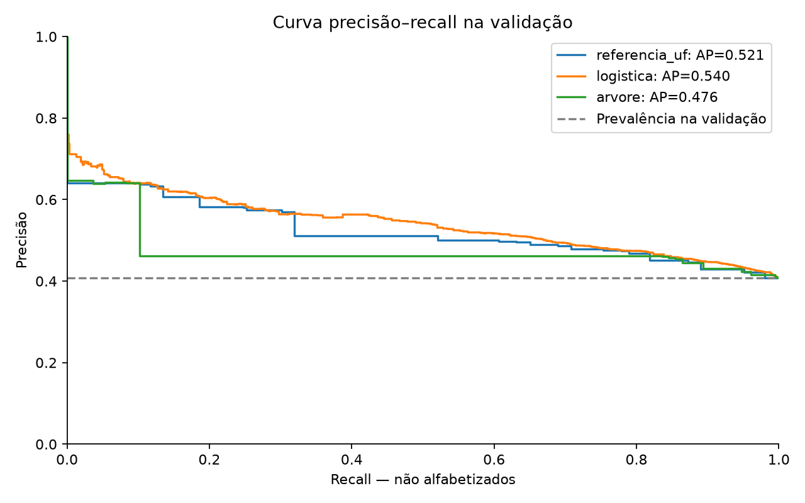
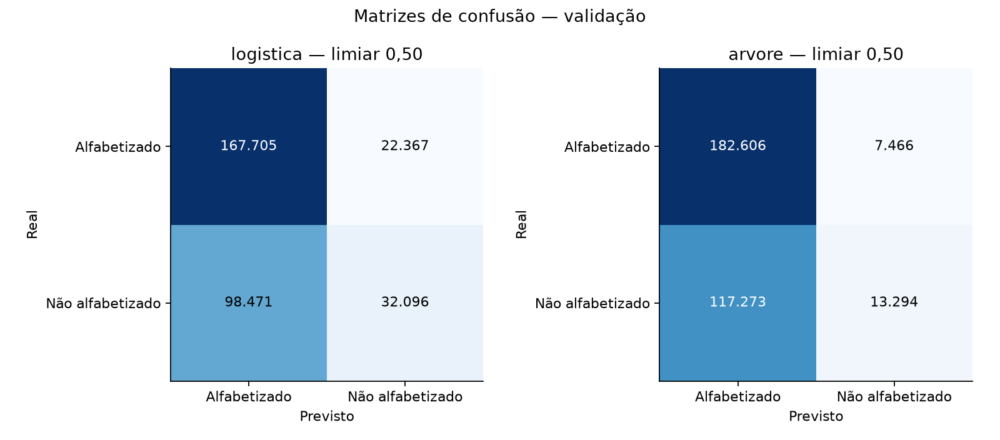

# Primeiros modelos — classificação individual de risco

Classe positiva: **não alfabetizado**, codificada como `1 - alfabetizado`. Limiar de classificação fixado previamente em 0,50; nenhuma otimização de limiar ou hiperparâmetros foi feita. Métrica principal para comparação: average precision (AP), resumo da curva precisão–recall. Não confundir AP com a área trapezoidal dessa curva. Recall mede a fração de não alfabetizados identificados; precisão mede a fração de alertas que corresponde a não alfabetizados.

## Conclusão desta rodada

A regressão logística obteve a maior AP: 0,5405, contra 0,5214 da referência por UF e 0,4755 da árvore. O ganho da logística sobre UF é 0,0190 em AP; sem intervalos por municípios, não se afirma significância estatística. A árvore inicial não superou a referência estadual nessa métrica.

No limiar fixo 0,50, a logística teve precisão 58,93%, recall 24,58% e F1 34,69%; deixou de identificar 98.471 dos 130.567 não alfabetizados da validação. A árvore teve precisão 64,04%, recall 10,18% e F1 17,57%. Há recall zero em 16 das 25 UFs na logística e 24 na árvore. A maior precisão da árvore não compensa automaticamente a baixa cobertura; isso depende do objetivo e custo dos erros.

A referência que alerta para todos alcança F1 de 57,87%, maior que os dois modelos no limiar padrão, mas gera 190.072 falsos positivos e não discrimina os alunos. Isso mostra por que F1 ou recall isolados não bastam. Os modelos não estão prontos para uso operacional.

Os modelos salvos foram recarregados e avaliados por uma segunda implementação que expandiu as contagens para os 320.639 alunos de validação: AP e matrizes de confusão coincidiram com os resultados ponderados. Nenhuma previsão foi calculada no teste.

O próximo experimento pode avaliar o compromisso precisão/recall por limiar e comparar modelos mais flexíveis com validação cruzada por município no treino. Também convém enriquecer atributos educacionais anteriores à avaliação: os preditores atuais não distinguem alunos dentro do mesmo município. Não escolher um limiar apenas para maximizar recall sem definir o custo ou a capacidade de atender alertas.

## Comparação na validação

| modelo | alunos | precision | recall | f1 | average_precision | roc_auc | accuracy | balanced_accuracy | brier |
| --- | --- | --- | --- | --- | --- | --- | --- | --- | --- |
| referencia_global | 320639 | 0.0000 | 0.0000 | 0.0000 | 0.4072 | 0.5000 | 0.5928 | 0.5000 | 0.2414 |
| referencia_uf | 320639 | 0.5741 | 0.3020 | 0.3958 | 0.5214 | 0.6377 | 0.6245 | 0.5740 | 0.2270 |
| logistica | 320639 | 0.5893 | 0.2458 | 0.3469 | 0.5405 | 0.6490 | 0.6231 | 0.5641 | 0.2258 |
| arvore | 320639 | 0.6404 | 0.1018 | 0.1757 | 0.4755 | 0.6044 | 0.6110 | 0.5313 | 0.2301 |
| referencia_todos_em_risco | 320639 | 0.4072 | 1.0000 | 0.5787 | 0.4072 | 0.5000 | 0.4072 | 0.5000 | 0.5928 |

Referência global: probabilidade constante igual à prevalência de risco no treino. Referência UF: probabilidade constante por UF, estimada somente no treino. Referência todos em risco: alerta para todos; recall=1 por construção, com baixa especificidade. Precisão e F1 são definidos como zero quando não há previsões positivas. Uma referência constante pode ter AP igual à prevalência mesmo sem prever positivos no limiar 0,50.

## Treino versus validação

| modelo | conjunto | precision | recall | f1 | average_precision | roc_auc | brier |
| --- | --- | --- | --- | --- | --- | --- | --- |
| logistica | treino | 0.5773 | 0.2767 | 0.3741 | 0.5324 | 0.6443 | 0.2258 |
| logistica | validacao | 0.5893 | 0.2458 | 0.3469 | 0.5405 | 0.6490 | 0.2258 |
| arvore | treino | 0.6403 | 0.1015 | 0.1752 | 0.4756 | 0.6052 | 0.2291 |
| arvore | validacao | 0.6404 | 0.1018 | 0.1757 | 0.4755 | 0.6044 | 0.2301 |

## Validação por UF

| modelo | uf | alunos | prevalencia_nao_alfabetizado | precision | recall | f1 | average_precision | roc_auc |
| --- | --- | --- | --- | --- | --- | --- | --- | --- |
| referencia_global | AC | 1151 | 0.5100 | 0.0000 | 0.0000 | 0.0000 | 0.5100 | 0.5000 |
| referencia_global | AL | 6044 | 0.5066 | 0.0000 | 0.0000 | 0.0000 | 0.5066 | 0.5000 |
| referencia_global | AM | 6045 | 0.5757 | 0.0000 | 0.0000 | 0.0000 | 0.5757 | 0.5000 |
| referencia_global | AP | 1192 | 0.5378 | 0.0000 | 0.0000 | 0.0000 | 0.5378 | 0.5000 |
| referencia_global | BA | 20760 | 0.6404 | 0.0000 | 0.0000 | 0.0000 | 0.6404 | 0.5000 |
| referencia_global | CE | 17538 | 0.1464 | 0.0000 | 0.0000 | 0.0000 | 0.1464 | 0.5000 |
| referencia_global | ES | 8107 | 0.2870 | 0.0000 | 0.0000 | 0.0000 | 0.2870 | 0.5000 |
| referencia_global | GO | 14150 | 0.2699 | 0.0000 | 0.0000 | 0.0000 | 0.2699 | 0.5000 |
| referencia_global | MA | 12569 | 0.3987 | 0.0000 | 0.0000 | 0.0000 | 0.3987 | 0.5000 |
| referencia_global | MG | 28486 | 0.2803 | 0.0000 | 0.0000 | 0.0000 | 0.2803 | 0.5000 |
| referencia_global | MS | 7302 | 0.4334 | 0.0000 | 0.0000 | 0.0000 | 0.4334 | 0.5000 |
| referencia_global | MT | 8740 | 0.3860 | 0.0000 | 0.0000 | 0.0000 | 0.3860 | 0.5000 |
| referencia_global | PA | 15467 | 0.5187 | 0.0000 | 0.0000 | 0.0000 | 0.5187 | 0.5000 |
| referencia_global | PB | 5965 | 0.4334 | 0.0000 | 0.0000 | 0.0000 | 0.4334 | 0.5000 |
| referencia_global | PE | 15161 | 0.3895 | 0.0000 | 0.0000 | 0.0000 | 0.3895 | 0.5000 |
| referencia_global | PI | 6195 | 0.3979 | 0.0000 | 0.0000 | 0.0000 | 0.3979 | 0.5000 |
| referencia_global | PR | 23926 | 0.2919 | 0.0000 | 0.0000 | 0.0000 | 0.2919 | 0.5000 |
| referencia_global | RJ | 25114 | 0.4474 | 0.0000 | 0.0000 | 0.0000 | 0.4474 | 0.5000 |
| referencia_global | RN | 3862 | 0.6116 | 0.0000 | 0.0000 | 0.0000 | 0.6116 | 0.5000 |
| referencia_global | RO | 3726 | 0.3704 | 0.0000 | 0.0000 | 0.0000 | 0.3704 | 0.5000 |
| referencia_global | RS | 12211 | 0.5472 | 0.0000 | 0.0000 | 0.0000 | 0.5472 | 0.5000 |
| referencia_global | SC | 10652 | 0.3541 | 0.0000 | 0.0000 | 0.0000 | 0.3541 | 0.5000 |
| referencia_global | SE | 3135 | 0.6179 | 0.0000 | 0.0000 | 0.0000 | 0.6179 | 0.5000 |
| referencia_global | SP | 59781 | 0.4391 | 0.0000 | 0.0000 | 0.0000 | 0.4391 | 0.5000 |
| referencia_global | TO | 3360 | 0.4988 | 0.0000 | 0.0000 | 0.0000 | 0.4988 | 0.5000 |
| referencia_uf | AC | 1151 | 0.5100 | 0.5100 | 1.0000 | 0.6755 | 0.5100 | 0.5000 |
| referencia_uf | AL | 6044 | 0.5066 | 0.5066 | 1.0000 | 0.6725 | 0.5066 | 0.5000 |
| referencia_uf | AM | 6045 | 0.5757 | 0.5757 | 1.0000 | 0.7307 | 0.5757 | 0.5000 |
| referencia_uf | AP | 1192 | 0.5378 | 0.0000 | 0.0000 | 0.0000 | 0.5378 | 0.5000 |
| referencia_uf | BA | 20760 | 0.6404 | 0.6404 | 1.0000 | 0.7808 | 0.6404 | 0.5000 |
| referencia_uf | CE | 17538 | 0.1464 | 0.0000 | 0.0000 | 0.0000 | 0.1464 | 0.5000 |
| referencia_uf | ES | 8107 | 0.2870 | 0.0000 | 0.0000 | 0.0000 | 0.2870 | 0.5000 |
| referencia_uf | GO | 14150 | 0.2699 | 0.0000 | 0.0000 | 0.0000 | 0.2699 | 0.5000 |
| referencia_uf | MA | 12569 | 0.3987 | 0.0000 | 0.0000 | 0.0000 | 0.3987 | 0.5000 |
| referencia_uf | MG | 28486 | 0.2803 | 0.0000 | 0.0000 | 0.0000 | 0.2803 | 0.5000 |
| referencia_uf | MS | 7302 | 0.4334 | 0.0000 | 0.0000 | 0.0000 | 0.4334 | 0.5000 |
| referencia_uf | MT | 8740 | 0.3860 | 0.0000 | 0.0000 | 0.0000 | 0.3860 | 0.5000 |
| referencia_uf | PA | 15467 | 0.5187 | 0.5187 | 1.0000 | 0.6830 | 0.5187 | 0.5000 |
| referencia_uf | PB | 5965 | 0.4334 | 0.0000 | 0.0000 | 0.0000 | 0.4334 | 0.5000 |
| referencia_uf | PE | 15161 | 0.3895 | 0.0000 | 0.0000 | 0.0000 | 0.3895 | 0.5000 |
| referencia_uf | PI | 6195 | 0.3979 | 0.0000 | 0.0000 | 0.0000 | 0.3979 | 0.5000 |
| referencia_uf | PR | 23926 | 0.2919 | 0.0000 | 0.0000 | 0.0000 | 0.2919 | 0.5000 |
| referencia_uf | RJ | 25114 | 0.4474 | 0.0000 | 0.0000 | 0.0000 | 0.4474 | 0.5000 |
| referencia_uf | RN | 3862 | 0.6116 | 0.6116 | 1.0000 | 0.7590 | 0.6116 | 0.5000 |
| referencia_uf | RO | 3726 | 0.3704 | 0.0000 | 0.0000 | 0.0000 | 0.3704 | 0.5000 |
| referencia_uf | RS | 12211 | 0.5472 | 0.5472 | 1.0000 | 0.7074 | 0.5472 | 0.5000 |
| referencia_uf | SC | 10652 | 0.3541 | 0.0000 | 0.0000 | 0.0000 | 0.3541 | 0.5000 |
| referencia_uf | SE | 3135 | 0.6179 | 0.6179 | 1.0000 | 0.7638 | 0.6179 | 0.5000 |
| referencia_uf | SP | 59781 | 0.4391 | 0.0000 | 0.0000 | 0.0000 | 0.4391 | 0.5000 |
| referencia_uf | TO | 3360 | 0.4988 | 0.0000 | 0.0000 | 0.0000 | 0.4988 | 0.5000 |
| logistica | AC | 1151 | 0.5100 | 0.4020 | 0.4123 | 0.4071 | 0.4759 | 0.4063 |
| logistica | AL | 6044 | 0.5066 | 0.5792 | 0.5349 | 0.5562 | 0.5708 | 0.5744 |
| logistica | AM | 6045 | 0.5757 | 0.6460 | 0.3026 | 0.4121 | 0.5953 | 0.5061 |
| logistica | AP | 1192 | 0.5378 | 0.0000 | 0.0000 | 0.0000 | 0.5019 | 0.3377 |
| logistica | BA | 20760 | 0.6404 | 0.6404 | 1.0000 | 0.7808 | 0.6649 | 0.5253 |
| logistica | CE | 17538 | 0.1464 | 0.0000 | 0.0000 | 0.0000 | 0.2475 | 0.6219 |
| logistica | ES | 8107 | 0.2870 | 0.0000 | 0.0000 | 0.0000 | 0.3409 | 0.5969 |
| logistica | GO | 14150 | 0.2699 | 0.0000 | 0.0000 | 0.0000 | 0.3040 | 0.5662 |
| logistica | MA | 12569 | 0.3987 | 0.0000 | 0.0000 | 0.0000 | 0.4077 | 0.5031 |
| logistica | MG | 28486 | 0.2803 | 0.0000 | 0.0000 | 0.0000 | 0.2951 | 0.5244 |
| logistica | MS | 7302 | 0.4334 | 0.0000 | 0.0000 | 0.0000 | 0.4561 | 0.5395 |
| logistica | MT | 8740 | 0.3860 | 0.0000 | 0.0000 | 0.0000 | 0.4048 | 0.5364 |
| logistica | PA | 15467 | 0.5187 | 0.5167 | 0.6855 | 0.5893 | 0.5233 | 0.5073 |
| logistica | PB | 5965 | 0.4334 | 0.0000 | 0.0000 | 0.0000 | 0.4898 | 0.5759 |
| logistica | PE | 15161 | 0.3895 | 0.0000 | 0.0000 | 0.0000 | 0.4288 | 0.5460 |
| logistica | PI | 6195 | 0.3979 | 0.0000 | 0.0000 | 0.0000 | 0.4746 | 0.5999 |
| logistica | PR | 23926 | 0.2919 | 0.0000 | 0.0000 | 0.0000 | 0.3547 | 0.5672 |
| logistica | RJ | 25114 | 0.4474 | 0.0000 | 0.0000 | 0.0000 | 0.5756 | 0.6383 |
| logistica | RN | 3862 | 0.6116 | 0.6116 | 1.0000 | 0.7590 | 0.6245 | 0.5116 |
| logistica | RO | 3726 | 0.3704 | 0.0000 | 0.0000 | 0.0000 | 0.3662 | 0.4918 |
| logistica | RS | 12211 | 0.5472 | 0.5587 | 0.8363 | 0.6699 | 0.5653 | 0.5304 |
| logistica | SC | 10652 | 0.3541 | 0.0000 | 0.0000 | 0.0000 | 0.3458 | 0.5012 |
| logistica | SE | 3135 | 0.6179 | 0.6179 | 1.0000 | 0.7638 | 0.6743 | 0.5814 |
| logistica | SP | 59781 | 0.4391 | 0.0000 | 0.0000 | 0.0000 | 0.4742 | 0.5481 |
| logistica | TO | 3360 | 0.4988 | 0.4816 | 0.2882 | 0.3606 | 0.4919 | 0.4942 |
| arvore | AC | 1151 | 0.5100 | 0.0000 | 0.0000 | 0.0000 | 0.5100 | 0.5000 |
| arvore | AL | 6044 | 0.5066 | 0.0000 | 0.0000 | 0.0000 | 0.5066 | 0.5000 |
| arvore | AM | 6045 | 0.5757 | 0.0000 | 0.0000 | 0.0000 | 0.5757 | 0.5000 |
| arvore | AP | 1192 | 0.5378 | 0.0000 | 0.0000 | 0.0000 | 0.5378 | 0.5000 |
| arvore | BA | 20760 | 0.6404 | 0.6404 | 1.0000 | 0.7808 | 0.6430 | 0.5037 |
| arvore | CE | 17538 | 0.1464 | 0.0000 | 0.0000 | 0.0000 | 0.1748 | 0.5829 |
| arvore | ES | 8107 | 0.2870 | 0.0000 | 0.0000 | 0.0000 | 0.2870 | 0.5000 |
| arvore | GO | 14150 | 0.2699 | 0.0000 | 0.0000 | 0.0000 | 0.2699 | 0.5000 |
| arvore | MA | 12569 | 0.3987 | 0.0000 | 0.0000 | 0.0000 | 0.3987 | 0.5000 |
| arvore | MG | 28486 | 0.2803 | 0.0000 | 0.0000 | 0.0000 | 0.3016 | 0.5333 |
| arvore | MS | 7302 | 0.4334 | 0.0000 | 0.0000 | 0.0000 | 0.4334 | 0.5000 |
| arvore | MT | 8740 | 0.3860 | 0.0000 | 0.0000 | 0.0000 | 0.3860 | 0.5000 |
| arvore | PA | 15467 | 0.5187 | 0.0000 | 0.0000 | 0.0000 | 0.5187 | 0.5000 |
| arvore | PB | 5965 | 0.4334 | 0.0000 | 0.0000 | 0.0000 | 0.4334 | 0.5000 |
| arvore | PE | 15161 | 0.3895 | 0.0000 | 0.0000 | 0.0000 | 0.3895 | 0.5000 |
| arvore | PI | 6195 | 0.3979 | 0.0000 | 0.0000 | 0.0000 | 0.3979 | 0.5000 |
| arvore | PR | 23926 | 0.2919 | 0.0000 | 0.0000 | 0.0000 | 0.2919 | 0.5000 |
| arvore | RJ | 25114 | 0.4474 | 0.0000 | 0.0000 | 0.0000 | 0.4474 | 0.5000 |
| arvore | RN | 3862 | 0.6116 | 0.0000 | 0.0000 | 0.0000 | 0.6116 | 0.5000 |
| arvore | RO | 3726 | 0.3704 | 0.0000 | 0.0000 | 0.0000 | 0.3704 | 0.5000 |
| arvore | RS | 12211 | 0.5472 | 0.0000 | 0.0000 | 0.0000 | 0.5472 | 0.5000 |
| arvore | SC | 10652 | 0.3541 | 0.0000 | 0.0000 | 0.0000 | 0.3541 | 0.5000 |
| arvore | SE | 3135 | 0.6179 | 0.0000 | 0.0000 | 0.0000 | 0.6179 | 0.5000 |
| arvore | SP | 59781 | 0.4391 | 0.0000 | 0.0000 | 0.0000 | 0.4391 | 0.5000 |
| arvore | TO | 3360 | 0.4988 | 0.0000 | 0.0000 | 0.0000 | 0.4988 | 0.5000 |

## Método e verificações

- Divisão refinada fixada, com hash conferido. Treino: 968.939 alunos em 3.267 municípios; validação: 320.639 alunos em 1.096 municípios. Nenhum município compartilhado. O teste não recebeu previsões nem métricas nesta etapa.
- As features atuais são constantes dentro do município. Por isso cada município foi representado por duas linhas com o mesmo X e rótulos 1/0, ponderadas pelas contagens dos alunos correspondentes. Isso preserva o objetivo individual e as métricas por aluno para um score constante dentro do município, sem inventar observações ou usar o peso amostral do INEP. Não é treinamento com taxa municipal como alvo contínuo.
- Pré-processamento ajustado somente em municípios de treino: imputação por mediana, escala padronizada e one-hot de UF. O ajuste da escala usa igual peso por município; a função de perda dos modelos usa contagem de alunos.
- Regressão logística L2, C=1, solver lbfgs. Árvore: profundidade máxima 5, folhas com no mínimo 1% do peso total de alunos do treino. Parâmetros fixados antes de observar os resultados; random_state=42. As contagens, não a quantidade de linhas comprimidas, regem a restrição de peso das folhas.
- Matrizes de confusão reconciliadas com os 320.639 alunos de validação. Colunas autorizadas verificadas; nenhum ID, proficiência ou resultado agregado de alfabetização entrou como feature.
- Modelos e preprocessamento salvos em arquivos joblib; usar somente estes artefatos locais confiáveis. Features, versões, parâmetros, advertências e métricas completas estão em `resultados.json`.

## Limites de interpretação

Todos os alunos do mesmo município recebem a mesma probabilidade, porque não há atributos individuais no conjunto de preditores. O resultado avalia o contexto territorial como preditor do rótulo individual; não diferencia dois alunos do mesmo município. O peso amostral do INEP não foi utilizado: métricas descrevem os alunos elegíveis observados, não uma estimativa oficial da população.

As métricas são pontuais e não têm intervalos de confiança nesta etapa. Alunos de um mesmo município não são observações independentes para estimar incerteza; eventual bootstrap deve reamostrar municípios. AP por UF pode ser igual à prevalência se todos recebem o mesmo score naquele estado; isso significa ausência de discriminação dentro da UF.

Usar a validação para comparar esta rodada inicial, sem declarar um modelo final. Hiperparâmetros e limiares posteriores devem ser ajustados sem consultar o teste, preferencialmente com validação cruzada por municípios no treino. A EDA anterior já observou a base completa, e os indicadores de referência 2021/2022 foram consultados em 2026: o teste é interno, não validação externa intocada ou temporal.

Referências técnicas: [LogisticRegression](https://scikit-learn.org/stable/modules/generated/sklearn.linear_model.LogisticRegression.html), [DecisionTreeClassifier](https://scikit-learn.org/stable/modules/generated/sklearn.tree.DecisionTreeClassifier.html), [average_precision_score](https://scikit-learn.org/stable/modules/generated/sklearn.metrics.average_precision_score.html).
