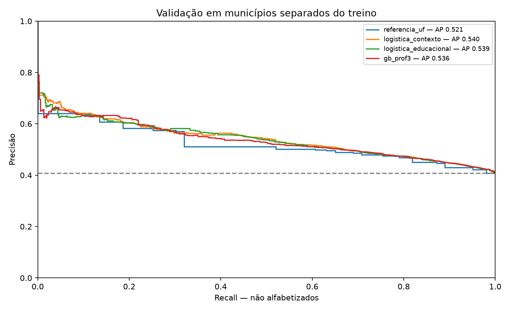
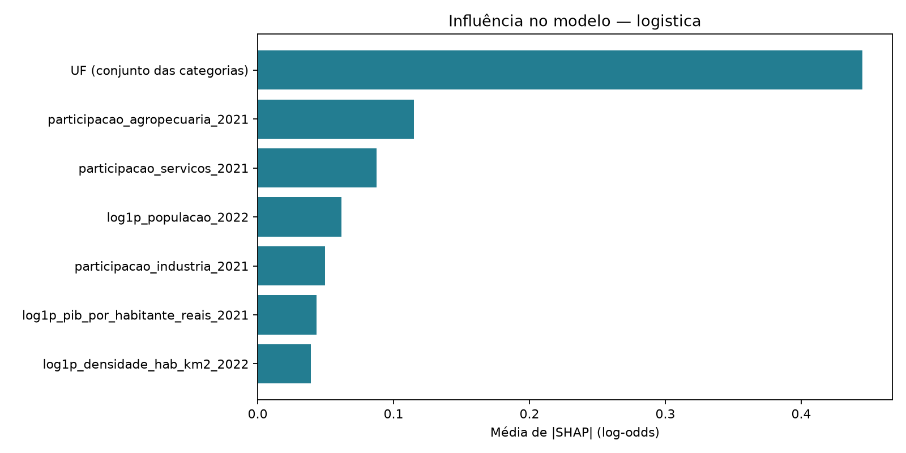
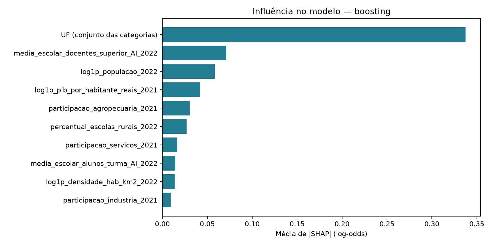
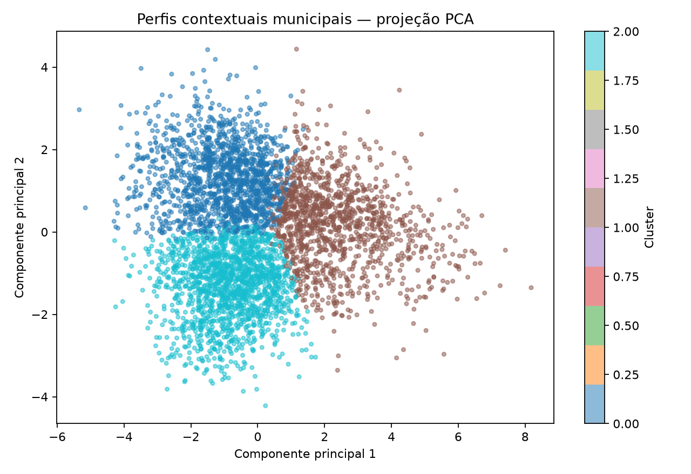
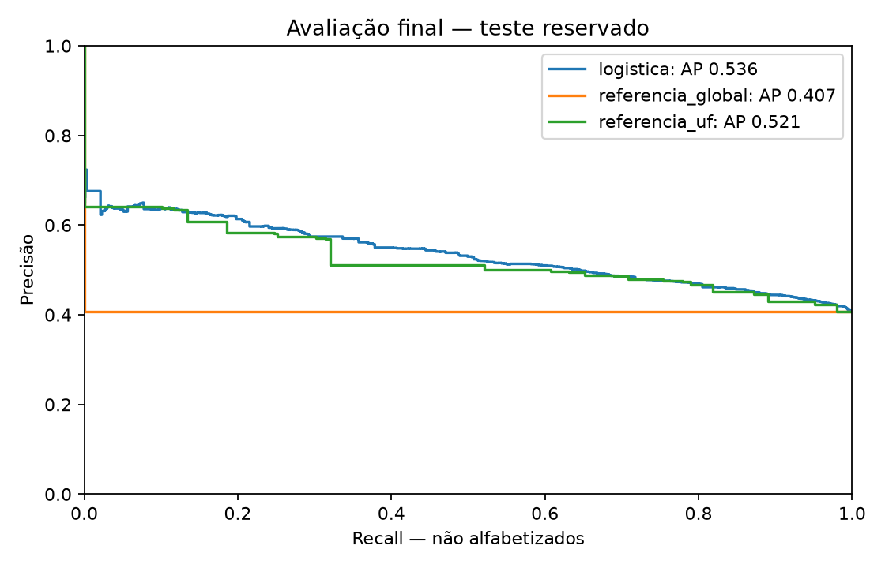

# Predição e inteligência analítica para alfabetização no Brasil

**Tech Challenge — Fase 3 | AI Scientist | Versão acadêmica 1.0 | 27/10/2026**

## Resultado principal

Foi construída uma pipeline reproduzível para prever o rótulo individual de não alfabetização usando contexto municipal anterior à avaliação. No teste final, com 321.176 alunos de 1.087 municípios reservados, a logística alcançou **AP=0.5356**, **ROC AUC=0.6434**, **precisão=58.96%**, **recall=27.12%** e **F1=37.15%** no limiar comparativo de 0,50.

O ganho sobre a referência por UF é pequeno, e a identificação dos não alfabetizados é baixa. Todos os alunos de um município recebem a mesma previsão. O projeto demonstra uma abordagem metodológica e seus limites; não apresenta o modelo como diagnóstico individual confiável nem como solução implantada.

## Problema, objetivo e hipóteses

O objetivo do enunciado é prever se um aluno será alfabetizado ou não, usando dados da Fase 2 e fontes complementares. O alvo foi recodificado para **1 = não alfabetizado** e **0 = alfabetizado**, tornando explícita a classe de interesse para recall e precisão. Perguntamos se contexto econômico, demográfico e educacional anterior ao exame acrescenta discriminação além da prevalência por UF.

A hipótese exploratória era que indicadores educacionais e modelos não lineares melhorariam a classificação. A rodada não demonstrou ganho claro na validação. Esse resultado foi preservado, sem procurar artificialmente uma divisão ou métrica que o tornasse favorável.

## Origem dos dados e relação com a Fase 2

O backup da Bronze da Fase 2 preserva 1.840.277 registros de alunos de 2024, rede municipal, segundo ano. Foram mantidas 1.610.754 avaliações válidas de 5.450 municípios e 36.920 grupos escolares. Os 229.523 registros inválidos tinham rótulo zero sem avaliação válida e foram excluídos, em vez de classificados automaticamente como não alfabetizados.

A Gold da Fase 2 contém 5.232 municípios, 24 UFs e 1.568.597 alunos cobertos. Foi reutilizada na auditoria, reconciliação, contexto descritivo e análise de cobertura. Não contém rótulos individuais. Para atender ao alvo por aluno, foi necessário recuperar os microdados Bronze, ampliar a tabela analítica e manter os 42.157 alunos elegíveis fora da Gold. Essa é uma adaptação explícita do requisito de usar a Gold; não se afirma que os rótulos individuais foram extraídos dela. Os arquivos Gold estão em `data/gold_fase2/`.

As fontes de contexto foram IBGE (população, área, densidade e PIB/estrutura econômica de 2021/2022) e INEP (indicadores educacionais de 2022). Não foi possível vincular os códigos escolares dos microdados aos códigos INEP: zero correspondências e nenhuma tabela de equivalência disponível. Como alternativa, calculamos médias simples por município dos indicadores das escolas municipais. Essas médias são proxies do projeto, não indicadores municipais oficiais ponderados por matrículas ou funções docentes.

## Qualidade, features e prevenção de vazamento

Os hashes dos sete extratos conferem com o manifesto e não foram detectadas duplicidades de chave na auditoria. As contagens municipais e estaduais Gold foram reconciliadas. Dois snapshots da Bronze são a mesma extração, não dois anos observados.

Proficiência separa perfeitamente o rótulo no ponto 743 neste backup; foi excluída. Também ficaram fora dos preditores os resultados de alfabetização de 2024, metas combinadas com o resultado, gap, ranking, presença e preenchimento usados no filtro, IDs, nomes e peso amostral. Usar esses campos poderia reconstruir a própria resposta ou uma informação indisponível antes do exame.

Na logística de referência entram log1p de população, densidade e PIB por habitante, participações de agropecuária, indústria e serviços e UF por one-hot. A média e o desvio da escala, a mediana de imputação e a codificação foram ajustados só no treino. As participações econômicas e suas dependências foram documentadas; não foram interpretadas causalmente.

O experimento enriquecido acrescentou médias escolares municipais de tamanho de turma, funções docentes com curso superior e proporção de escolas rurais. Valores ausentes foram imputados somente dentro dos folds de treino. Não houve truncamento arbitrário dos valores econômicos atípicos de Cachoeira Dourada/GO.

## EDA e cobertura

Na base válida, 59,37% são alfabetizados e 40,63% não alfabetizados. Há grande variação entre UFs: CE=85,36% alfabetizados e BA=35,96%, neste recorte. A mediana municipal é 64,17%, e 617 municípios têm menos de 30 avaliações. Taxas de extremos em amostras pequenas têm menor estabilidade.

Os alunos de municípios fora da Gold têm taxa de alfabetização de 46,52%, contra 59,72% nos incluídos. Excluir o primeiro grupo mudaria a composição da base. A cobertura bruta não é representativa de toda a educação brasileira; as taxas não são o indicador oficial do INEP.

## Validação e comparação

A divisão municipal refinada ficou fixada antes dos modelos finais: treino com 968.939 alunos em 3.267 municípios, validação com 320.639 em 1.096 e teste com 321.176 em 1.087. Todos os conjuntos contêm as 25 UFs presentes nos microdados e ambas as classes. Nenhum município aparece em mais de um conjunto.

As proporções de alunos e classes foram equilibradas por UF sem dividir municípios. A diferença máxima de taxa por UF caiu de 25,15 para 4,63 pontos percentuais. O equilíbrio não é perfeito, especialmente em estados concentrados em poucos municípios. A EDA observou previamente a base completa, portanto o teste é interno e não uma validação externa intocada.

Os municípios do treino foram divididos em três folds estratificados por UF. Logística, duas configurações de Random Forest e duas de Gradient Boosting foram comparadas por AP média. A floresta usa aleatoriedade de atributos sem bootstrap, para não confundir bootstrap de linhas municipais comprimidas com amostragem de alunos. O boosting usa todas as linhas ponderadas e não faz parada antecipada com divisão aleatória de alunos.

O boosting de profundidade 3 foi selecionado pela CV, mas na validação não superou a logística contextual anterior. O intervalo bootstrap de municípios para o ganho de AP do boosting frente à logística foi [−0,0148; 0,0053], condicional aos ajustes. Mantivemos a logística como referência por simplicidade e ausência de ganho claro, registrando a decisão antes de abrir o teste. Não há prova de superioridade universal desse algoritmo.

| model | AP | ROC_AUC | precision | recall | F1 |
| --- | --- | --- | --- | --- | --- |
| logistica_contexto | 0.5405 | 0.6490 | 0.5893 | 0.2458 | 0.3469 |
| logistica_educacional | 0.5385 | 0.6483 | 0.5929 | 0.2447 | 0.3464 |
| rf_prof8 | 0.5301 | 0.6394 | 0.6131 | 0.1684 | 0.2642 |
| rf_prof12 | 0.5347 | 0.6440 | 0.5971 | 0.2155 | 0.3167 |
| gb_prof2 | 0.5313 | 0.6394 | 0.6174 | 0.1374 | 0.2248 |
| gb_prof3 | 0.5357 | 0.6452 | 0.5922 | 0.2544 | 0.3559 |
| referencia_global | 0.4072 | 0.5000 | 0.0000 | 0.0000 | 0.0000 |
| referencia_uf | 0.5214 | 0.6377 | 0.5741 | 0.3020 | 0.3958 |

## Interpretação dos modelos

SHAP foi calculado em uma amostra fixa de 500 municípios da validação, usando somente treino como background. Na logística, o background efetivo tem 200 municípios; no TreeExplainer, 100 após a subamostragem padrão da biblioteca. A soma do valor base e das contribuições foi conferida contra o logit de cada previsão.

O SHAP interventional explica o comportamento do modelo sob uma referência que quebra dependências entre atributos. Diante de colinearidade e categorias one-hot, não deve ser lido como efeito causal ou contrafactual válido de mudar um estado. As contribuições das categorias de UF foram somadas por linha antes da importância global. A média usa igual peso municipal.

UF foi o grupo de maior influência nos dois modelos. Na logística, as participações de agropecuária e serviços vêm a seguir; no boosting, a proxy municipal de formação docente aparece após UF. Os coeficientes e exemplos locais anônimos estão em `reports/avaliacao-final/interpretacao.json`.

## Perfis de municípios semelhantes

Para explorar padrões sem rótulo, comparamos K-Means com k=3,4,5, usando só as features numéricas e ajustando imputação, escala e escolha de k no treino. K=3 teve silhouette de 0,2114, muito próxima de k=4 (0,2106); logo, os perfis não são grupos fortemente separados. PCA foi usada para visualização, não como prova de agrupamento.

Os perfis de treino incluem um grupo de municípios menores com elevada proxy de formação docente, outro de municípios maiores com turmas maiores e um terceiro com menor PIB/habitante e maior proporção de escolas rurais. Isso apoia comparação de contextos e formulação de hipóteses, não classificação causal de vulnerabilidade. Não foi verificada estabilidade por bootstrap dos clusters.

## Avaliação final no teste reservado

O protocolo, hash do modelo e limiar comparativo foram gravados antes da leitura do teste. O modelo já treinado foi aplicado uma vez, sem reajuste. As métricas foram verificadas independentemente expandindo os mesmos scores para as contagens dos 321.176 alunos; não houve nova seleção de modelo. O teste está encerrado para esta versão.

| modelo | students | AP | ROC_AUC | precision | recall | F1 | Brier | FP | FN |
| --- | --- | --- | --- | --- | --- | --- | --- | --- | --- |
| logistica | 321176 | 0.5356 | 0.6434 | 0.5896 | 0.2712 | 0.3715 | 0.2265 | 24678 | 95310 |
| referencia_global | 321176 | 0.4072 | 0.5000 | 0.0000 | 0.0000 | 0.0000 | 0.2414 | 0 | 130768 |
| referencia_uf | 321176 | 0.5212 | 0.6374 | 0.5740 | 0.3014 | 0.3953 | 0.2270 | 29252 | 91349 |

A logística identificou 35,458 não alfabetizados e deixou de identificar 95,310; gerou 24,678 falsos positivos. O desempenho no teste confirma a limitação observada na validação. As métricas completas por UF estão em `reports/avaliacao-final/resultados_teste.json`.

## Limiares, valor estratégico e restrições de uso

Não foi escolhida capacidade real de atendimento nem limiar operacional, por decisão do usuário. O valor 0,50 serve somente para comparar métricas. Cenários de limiar mostram o compromisso entre cobertura e falsos alertas. No boosting, um limiar derivado de OOF para buscar recall de 80% no treino alcançou 79,65% na validação, mas alertou 68,46% dos alunos. Isso não é uma recomendação de atender essa proporção.

O valor estratégico desta versão está em evidenciar desigualdades territoriais, limites de cobertura, custo de falsos alertas e a necessidade de dados anteriores e mais granulares. Os modelos podem apoiar investigação e planejamento agregado; não sustentam diagnóstico ou decisões individuais automatizadas.

## Limitações e evolução

- Ausência de atributos pessoais ou escolares vinculáveis: a probabilidade é igual para alunos de um município.
- Há apenas um ano observado do alvo. Metas futuras e snapshots repetidos não permitem ARIMA/SARIMA ou backtest temporal legítimo.
- Não existem ações, recompensas ou transições para aprendizado por reforço. Seu uso foi considerado e não aplicado.
- Fontes de referência anterior ao exame foram consultadas em 2026 e podem ter revisões. Não há garantia de disponibilidade exata da mesma versão em 2023.
- Os pesos usados nos modelos são contagens de alunos, não pesos amostrais do INEP. Métricas descrevem o recorte observado.
- As médias educacionais municipais são calculadas sem denominadores de matrículas, turmas ou funções docentes; não são indicadores municipais oficiais.
- SQLite foi apoio local de preparação/auditoria. A entrega reproduzível usa JSON agregado e pipelines Scikit-learn; nenhuma arquitetura cloud é imposta por essa escolha.

A evolução recomendada é obter uma chave escolar legítima ou atributos individuais autorizados anteriores à avaliação, ampliar os anos observados, avaliar calibração e estabilidade por grupos, e manter avaliação futura separada. Não reajustar esta versão após o teste.
